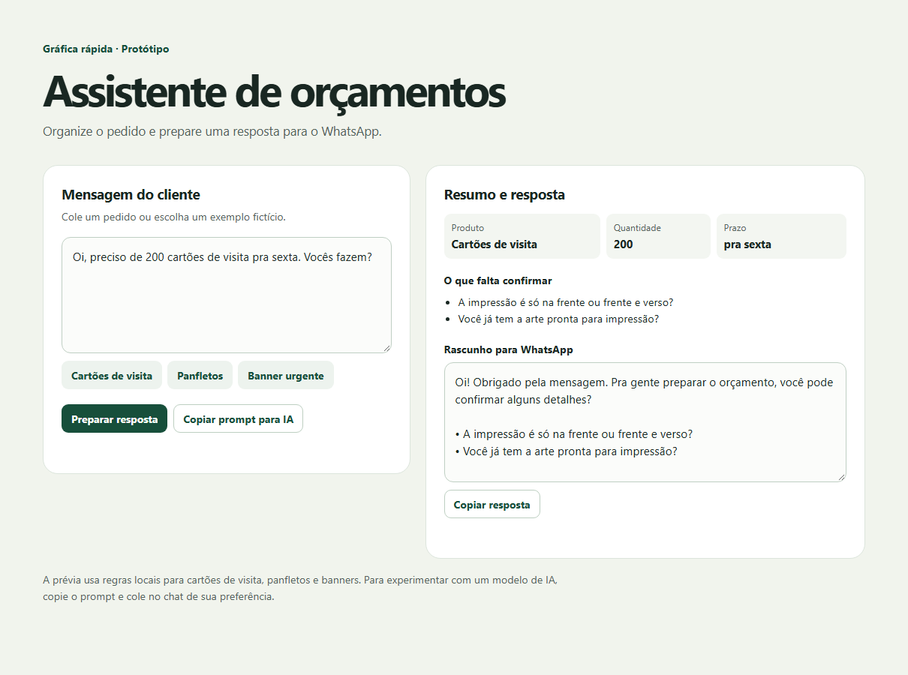

# Assistente de orçamentos para gráficas

Protótipo para gráficas rápidas que recebem pedidos pelo WhatsApp. A partir da mensagem do cliente, a página destaca o produto, a quantidade e o prazo, sugere perguntas sobre as informações que faltam e prepara uma resposta editável para a equipe revisar e copiar.

[**Experimentar a demo**](https://andg087.github.io/assistente-de-orcamentos/)



## Experimente

1. Escolha **Cartões de visita**, **Panfletos** ou **Banner urgente**. Você também pode colar uma mensagem de exemplo.
2. Clique em **Preparar resposta** e confira o resumo e as perguntas.
3. Edite o rascunho e clique em **Copiar resposta**.

## Como funciona

A prévia usa regras de texto para identificar os três tipos de produto. A análise roda no navegador e sinaliza campos ausentes ou que precisam de confirmação. A equipe continua responsável por preço, disponibilidade e envio da resposta.

O botão **Copiar prompt para IA** prepara o mesmo pedido para testar em um chat de IA externo. A página não faz chamadas a modelos nem envia a mensagem do cliente. Para testes em um chat externo, use exemplos fictícios ou anonimizados.

## Rode no seu computador

Baixe ou clone o repositório e abra `index.html` no navegador. A página usa HTML, CSS e JavaScript, sem instalação de dependências.

```text
index.html          Interface do assistente
assets/styles.css   Estilos da página
js/orcamento.js     Regras de extração e prompt para IA
js/app.js           Interações da interface e cópia do texto
tests/              Testes das regras do protótipo
```

Para rodar os testes, use Node.js 22 ou superior:

```sh
node --test
```

## Próximo passo do projeto

Testar com uma gráfica e comparar o tempo de preparo manual com o tempo de gerar e revisar o rascunho. Registrar quais sugestões foram aproveitadas e quais precisaram de correção. A demonstração usa pedidos fictícios.
